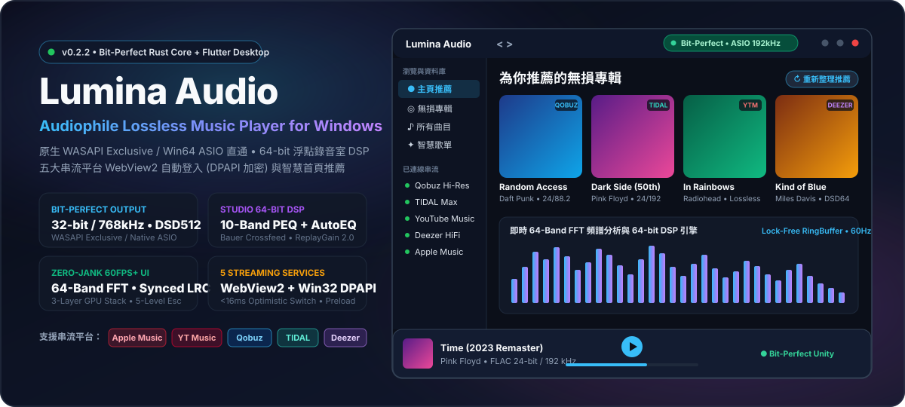
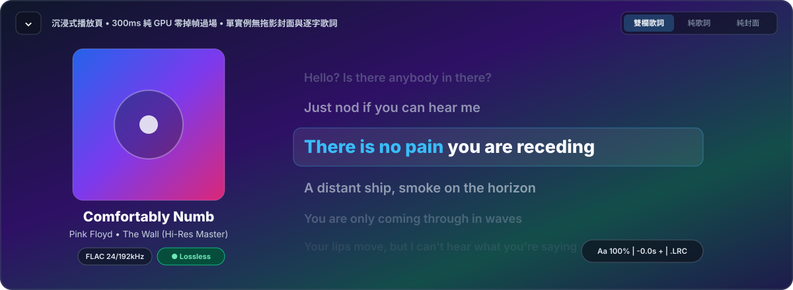
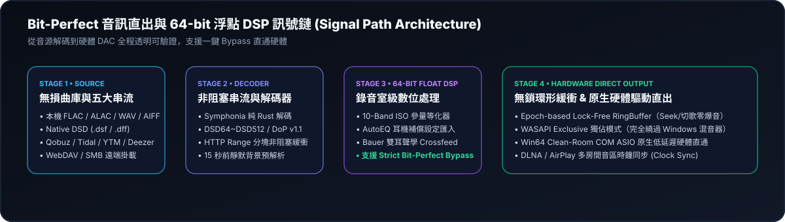
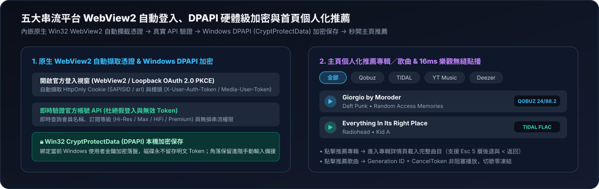
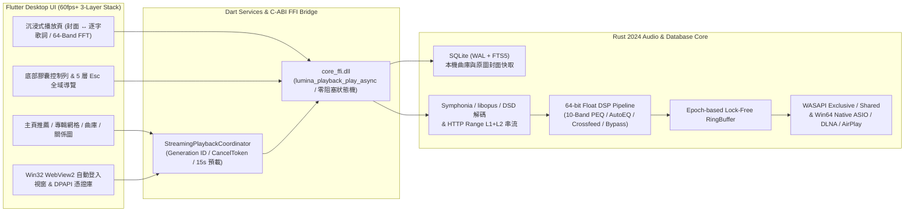

<div align="center">

# 🎵 Lumina Audio

**專為發燒友與高解析音樂愛好者打造的現代化 Windows 桌面端無損音樂播放器**  
*Audiophile Lossless Music Player for Windows — Powered by Rust 2024 & Flutter Desktop*

<p align="center">
  <a href="https://github.com/pierre930523/lumina-audio/releases/latest">
    
  </a>
  
  
  
  
  
</p>

<p align="center">
  
</p>

<p align="center">
  <a href="https://github.com/pierre930523/lumina-audio/releases/latest"><strong>⬇️ 下載最新 Windows NSIS 安裝包 (Lumina-Audio-Setup-v0.2.4.exe)</strong></a>
  &nbsp;•&nbsp;
  <a href="#-核心特色與技術亮點-key-features">核心特色</a>
  &nbsp;•&nbsp;
  <a href="#-視覺與架構導覽-visual--architecture-tour">圖文導覽</a>
  &nbsp;•&nbsp;
  <a href="#-建置與-nsis-打包指南-build--nsis-packaging">建置與打包</a>
</p>

</div>

---

## 🌟 軟體簡介 (Overview)

**Lumina Audio** 是一款結合 **頂級 Hi-Fi Bit-Perfect 聲音表現** 與 **60fps+ 現代桌面端沉浸美學** 的 Windows 原生無損音樂播放器：

- **底層音訊核心 (`Rust 2024`)**：採用無鎖環形緩衝區（Epoch-based Lock-Free RingBuffer）、原生 **WASAPI Exclusive（獨佔模式）**、**Win64 Clean-Room COM ASIO** 與 **Native DSD / DoP v1.1** 硬體直出，完全繞過 Windows 系統混音器（Audio Engine / APO），杜絕重取樣失真。
- **錄音室級數位處理 (`64-bit Float DSP`)**：內建 10-Band ISO 參量等化器（PEQ）、AutoEQ 耳機頻響匯入、Bauer 雙耳聲學 Crossfeed 與 ReplayGain 2.0 防削波限制器，並支援 **一鍵 Strict Bit-Perfect Bypass**。
- **五大串流平台整合與智慧推薦**：原生整合 **Qobuz**、**TIDAL**、**YouTube Music**、**Deezer** 與 **Apple Music**，支援 **Win32 WebView2 內嵌網頁自動登入擷取憑證**、**Windows DPAPI (`CryptProtectData`) 硬體級加密保存**、**主頁個人化推薦專輯／歌曲** 與 **16ms 樂觀切歌非阻塞串流引擎**。

---

## 🖼️ 視覺與架構導覽 (Visual & Architecture Tour)

### 1. 沉浸式播放介面、逐字同步歌詞與 300ms 純 GPU 零掉幀過場
<p align="center">
  
</p>

- **恆定 3 層 `RepaintBoundary` 架構**：底層主介面、全螢幕播放覆蓋層與底部迷你播放列各自獨立繪製，展開與收合播放頁時底層元件 **零拆卸、零重建**。
- **首幀重負載錯開（Zero First-Frame Jank）**：進場動畫期間以純 GPU `SlideTransition` + `FadeTransition`（`300ms`, `Curves.easeOutCubic`）滑入，待 `AnimationStatus.completed` 後才啟動 60Hz FFT 頻譜分析與歌詞對齊；關閉瞬間第 1 幀即刻暫停 FFT。
- **單實例無拖影「封面 ↔ 歌詞」切換**：封面與曲目資訊於「純封面 / 雙欄分割 / 純歌詞」三種檢視模式間平滑位移縮放，搭配 LRC 逐行／逐字高亮與時間偏移微調。

---

### 2. Bit-Perfect 硬體直出與 64-bit 浮點 DSP 訊號鏈
<p align="center">
  
</p>

- **透明 Signal Path 面板**：即時檢視「音源格式 → 解碼器 → 64-bit DSP 狀態 → 輸出驅動與硬體取樣率」完整路徑與品質燈號（Lossless / Enhanced / High Quality）。
- **硬體取樣率自動協商**：自動偵測 USB DAC 支援之真實取樣率（`44.1kHz ~ 768kHz`）與位元深度（`16/24/32-bit`），以及 `DSD64 ~ DSD512` 原生或 DoP 封裝直出。
- **64-Band 即時頻譜視覺化**：具備 4 因子靜止保證（`enabled && isPlaying && isVisible && !isMinimized`），背景或最小化至系統匣時自動關閉音訊 Tap，達到 **0% 背景 CPU/GPU 額外耗電**。

---

### 3. 五大串流平台 WebView2 自動登入、DPAPI 加密與主頁個人化推薦
<p align="center">
  
</p>

- **內嵌原生 Win32 WebView2 自動抓取憑證**：點擊「開啟網頁登入（自動擷取憑證）」即彈出原生暗色標題列 WebView2 視窗，透過 `ICoreWebView2CookieManager::GetCookies`（支援 `HttpOnly` Cookie）與 `WebResourceRequested` 自動攔截所需授權憑證，驗證真實 API 後自動關閉視窗並以 **Windows DPAPI** 加密保存（同時保留本機 `127.0.0.1` Loopback OAuth 2.0 PKCE 與進階手動輸入 Token 備援）。
- **主頁「為你推薦的專輯」與「推薦歌曲」**：登入後與啟動時於背景非阻塞拉取各平台個人化推薦 Feed（搭配 20 分鐘本機快取秒開、骨架屏 Skeleton、多平台篩選膠囊與卡片來源角標）。
- **零凍結非阻塞串流切歌狀態機 (`StreamingPlaybackCoordinator`)**：
  - **16ms 內樂觀 UI 更新**：切歌瞬間立即切換曲名、歌手、封面並於播放鈕顯示輕量轉圈。
  - **Generation ID (`_playRequestId`) + `CancelToken` + Rust `lumina_playback_play_async`**：連續快速切歌時強制取消舊 HTTP 請求與舊解碼任務，搭配 200ms 連點防抖與 **歌曲剩餘 15 秒背景靜默預解析下一首 URL**。

---

## ✨ 核心特色與技術亮點 (Key Features)

| 功能領域 | 核心規格與實作細節 |
| :--- | :--- |
| **🎧 硬體音訊直出** | Windows **WASAPI Exclusive / Shared**、**Win64 Clean-Room COM ASIO**、**Native DSD / DoP v1.1**、**Strict Bit-Perfect Unity Volume** |
| **🎛️ 64-bit 浮點 DSP** | **10-Band ISO PEQ**、**AutoEQ 設定檔匯入**、**Bauer Crossfeed**、**ReplayGain 2.0 + 防削波 Limiter**、**一鍵 Bypass** |
| **🌐 五大串流與遠端** | **Qobuz**、**TIDAL**、**YouTube Music**、**Deezer**、**Apple Music**（含 FairPlay DRM 誠實提示與官方試聽／網頁聯動）、**WebDAV / SMB** |
| **⚡ 桌面互動與快捷鍵** | 單一全域 `HardwareKeyboard` **5 層 `Esc` 後退優先級**（輸入框取消焦點 → 浮層／對話框 → 退出 `F11` 全螢幕 → 收合播放頁 → 瀏覽歷史 `<` 後退）、100% 寬度頂部 `WindowDragBar` 拖曳與雙擊最大化 |
| **📥 系統匣與斷點續播** | 原生 Win32 `NOTIFYICONDATAW` **最小化至系統匣背景播放**（含右鍵快捷選單與 `TaskbarCreated` 自動恢復）、重啟後 **毫秒級精準還原曲目與進度（Paused 待命不誤播）** |
| **🖥️ 多螢幕與高 DPI** | Windows Per-Monitor V2 DPI 自適應（`100% ~ 200%` 系統縮放 + 軟體內建 `Ctrl + +/-/0` 無段縮放），HiDPI 原圖封面快取 |

---

## 🏛️ 系統架構 (System Architecture)



### 原始碼目錄結構 (Source Repository Layout)

```text
lumina-audio/
├── Cargo.toml                       # Rust Workspace 設定 (Rust 2024 Edition)
├── crates/
│   ├── core-types/                  # 共用資料模型 (Album, Track,AudioFormat, SignalPath, Zone)
│   ├── core-db/                     # SQLite (WAL + FTS5) 音樂庫索引、搜尋與設定儲存
│   ├── core-providers/              # 本機目錄掃描、CJK 標籤編碼修復、封面萃取、WebDAV/SMB
│   ├── core-audio/                  # Symphonia/DSD 解碼、HTTP Range 串流、64-bit DSP、WASAPI/ASIO、FFT
│   ├── core-server/                 # 多房間音區 (DLNA/AirPlay)、時鐘同步與遠端配對服務
│   └── core-ffi/                    # C-ABI 動態庫橋接層 (core_ffi.dll，含非阻塞 play_async)
├── app/                             # Flutter Windows 桌面端應用程式
│   ├── lib/
│   │   ├── models/                  # 播放狀態、音訊格式、串流與推薦資料模型
│   │   ├── services/                # FFI 音訊服務、5 大串流 Provider、WebView2/DPAPI、非阻塞切歌協調器
│   │   ├── shaders/                 # GLSL Fragment Shaders (流體網格背景與毛玻璃特效)
│   │   ├── ui/                      # 深色沉浸式 UI (主頁推薦、專輯詳情、Now Playing、歌詞、DSP、設定)
│   │   └── main.dart                # 應用程式與 Per-Monitor DPI 縮放入口
│   ├── windows/runner/              # 原生 Win32 視窗、系統匣、DPAPI 加解密與 WebView2 COM 授權視窗
│   └── test/                        # 369 項單元、Widget、串流協定與效能回歸測試
├── docs/assets/                     # README 介面架構與視覺預覽 SVG 圖檔
└── installer/
    └── lumina_setup.nsi             # NSIS Modern UI 2 Windows 安裝包封裝腳本
```

---

## 🚀 建置與 NSIS 打包指南 (Build & NSIS Packaging)

### 必備環境 (Prerequisites)
1. **Windows 10 / 11 (x64)**
2. **Flutter SDK** `3.14.0+` 與 **Rust Toolchain** (`stable-x86_64-pc-windows-msvc`)
3. **Visual Studio 2022**（「使用 C++ 的桌面開發」工作負載）
4. **NSIS (Nullsoft Scriptable Install System)** `3.x`（用於打包 `Lumina-Audio-Setup-v0.2.4.exe`）

### 1. 編譯 Rust 核心與 Flutter Windows Release
```powershell
# 1. 編譯 Rust FFI 核心動態庫 (core_ffi.dll)
cargo build --release -p core-ffi

# 2. 一鍵準備依賴並編譯 Flutter Windows Release（或手動於 app/ 執行 flutter build windows --release）
powershell -ExecutionPolicy Bypass -File scripts\build_release.ps1 -SkipPrepareDeps
```

### 2. 使用 NSIS 封裝 Windows 安裝包
```powershell
# 確保輸出目錄存在並執行 makensis 編譯安裝包
New-Item -ItemType Directory -Force -Path dist | Out-Null
makensis installer\lumina_setup.nsi
# 產出：dist\Lumina-Audio-Setup-v0.2.4.exe
```

---

## 🧪 測試驗證矩陣 (Verification Matrix)

| 驗證項目 | 執行指令 | 驗證結果 |
| :--- | :--- | :---: |
| **Flutter 靜態分析** | `cd app && flutter analyze` | **0 issues** |
| **Flutter 全域測試套件** | `cd app && flutter test --timeout 45s -j 1` | **369 / 369 Passed (100%)** |
| **Rust 核心測試套件** | `cargo test --workspace` | **All Passed (100%)** |
| **Windows Release & NSIS 封裝** | `flutter build windows --release && makensis installer\lumina_setup.nsi` | **Exit 0** |

---

## 📄 授權條款 (License)

本專案採用 **MIT License** 開源授權，歡迎音響發燒友與開發者共同交流與貢獻！
