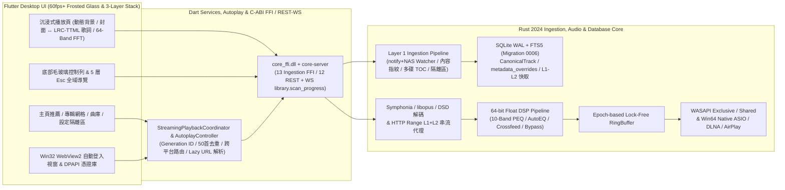

<div align="center">

# 🎵 Lumina Audio

**專為發燒友與高解析音樂愛好者打造的現代化 Windows 桌面端無損音樂播放器**  
*Audiophile Lossless Music Player for Windows — Powered by Rust 2024 & Flutter Desktop*

<p align="center">
  <a href="https://github.com/pierre930523/lumina-audio/releases/latest">
    
  </a>
  
  
  
  
  
</p>

<p align="center">
  
</p>

<p align="center">
  <a href="https://github.com/pierre930523/lumina-audio/releases/latest"><strong>⬇️ 下載最新 Windows NSIS 安裝包 (Lumina-Audio-Setup-v0.2.6.exe)</strong></a>
  &nbsp;•&nbsp;
  <a href="https://github.com/pierre930523/lumina-audio/releases/latest"><strong>📦 免安裝攜帶版 (Lumina-Audio-v0.2.6-Windows-x64.zip)</strong></a>
  &nbsp;•&nbsp;
  <a href="#-核心特色與技術亮點-key-features">核心特色</a>
  &nbsp;•&nbsp;
  <a href="#-視覺與架構導覽-visual--architecture-tour">圖文導覽</a>
  &nbsp;•&nbsp;
  <a href="#-建置與-nsis-打包指南-build--nsis-packaging">建置與打包</a>
</p>

</div>

---

## 🌟 軟體簡介 (Overview)

**Lumina Audio** 是一款結合 **頂級 Hi-Fi Bit-Perfect 聲音表現**、**Roon 級第一層來源匯入層（Ingestion Layer）** 與 **60fps+ 毛玻璃動態流體美學** 的 Windows 原生無損音樂播放器：

- **底層音訊核心 (`Rust 2024`)**：採用無鎖環形緩衝區（Epoch-based Lock-Free RingBuffer）、原生 **WASAPI Exclusive（獨佔模式）**、**Win64 Clean-Room COM ASIO** 與 **Native DSD / DoP v1.1** 硬體直出，完全繞過 Windows 系統混音器（Audio Engine / APO），杜絕重取樣失真。
- **第一層：來源匯入層 (`Ingestion Layer`)**：雙軌檔案監控（OS 原生 `notify` + 750ms 防抖／NAS 增量輪詢與離線磁碟保護）、標籤無關音訊內容指紋（搬移／改名原地重連保留播放紀錄與收藏）、啟發式多碟分組（`CD1`/`Disc 2`）與 `TocSignature`、異常隔離區（`SkippedFiles`）、`.ttml`／`.m3u8` 附屬資源、非破壞性 `metadata_overrides`（`UserEdit > CloudEnrichment > FileTag`）與串流輕量目錄正規化。
- **錄音室級數位處理 (`64-bit Float DSP`)**：內建 10-Band ISO 參量等化器（PEQ）、AutoEQ 耳機頻響匯入、Bauer 雙耳聲學 Crossfeed 與 ReplayGain 2.0 防削波限制器，並支援 **一鍵 Strict Bit-Perfect Bypass**。
- **五大串流平台整合與跨平台智慧接播**：原生整合 **Qobuz**、**TIDAL**、**YouTube Music**、**Deezer** 與 **Apple Music**，支援 **Win32 WebView2 內嵌網頁自動登入擷取憑證**、**Windows DPAPI (`CryptProtectData`) 硬體級加密保存**、**50 首去重／藝人冷卻無限接播與 Last.fm / ListenBrainz / 本機無損曲庫跨平台音質路由**，以及 **16ms 樂觀切歌非阻塞串流引擎**。

---

## 🖼️ 視覺與架構導覽 (Visual & Architecture Tour)

### 1. 沉浸式毛玻璃播放介面、動態封面流體背景與 300ms 零掉幀過場
<p align="center">
  
</p>

- **全視窗共享動態背景與毛玻璃容器**：透過 `AmbientDynamicBackground` 與自訂 GLSL Fragment Shaders（`liquid_glass.frag`、`mesh_fluid_bg.frag`）即時抽取封面主色調渲染流體漸層與條件式毛玻璃控制列。
- **恆定 3 層 `RepaintBoundary` 架構**：底層主介面、全螢幕播放覆蓋層與底部迷你播放列各自獨立繪製，展開與收合播放頁時底層元件 **零拆卸、零重建**。
- **首幀重負載錯開（Zero First-Frame Jank）**：進場動畫期間以純 GPU `SlideTransition` + `FadeTransition`（`300ms`, `Curves.easeOutCubic`）滑入，待 `AnimationStatus.completed` 後才啟動 60Hz FFT 頻譜分析與歌詞對齊；關閉瞬間第 1 幀即刻暫停 FFT。
- **單實例無拖影「封面 ↔ 歌詞」切換**：支援內嵌與外掛 `.lrc` / `.ttml` 逐行與逐字高亮歌詞、時間偏移微調及即時音質資訊彈窗。

---

### 2. Bit-Perfect 硬體直出與 64-bit 浮點 DSP 訊號鏈
<p align="center">
  
</p>

- **透明 Signal Path 面板**：即時檢視「音源格式 → 解碼器 → 64-bit DSP 狀態 → 輸出驅動與硬體取樣率」完整路徑與音質等級徽章（Lossless / Hi-Res / Enhanced / High Quality）。
- **硬體取樣率自動協商**：自動偵測 USB DAC 支援之真實取樣率（`44.1kHz ~ 768kHz`）與位元深度（`16/24/32-bit`），以及 `DSD64 ~ DSD512` 原生或 DoP 封裝直出。
- **64-Band 即時頻譜視覺化**：具備 4 因子靜止保證（`enabled && isPlaying && isVisible && !isMinimized`），背景或最小化至系統匣時自動關閉音訊 Tap，達到 **0% 背景 CPU/GPU 額外耗電**。

---

### 3. 五大串流平台 WebView2 自動登入、跨平台無限接播與來源匯入層
<p align="center">
  
</p>

- **內嵌原生 Win32 WebView2 自動抓取憑證**：透過 `ICoreWebView2CookieManager::GetCookies` 與 `WebResourceRequested` 自動攔截所需授權憑證，驗證真實 API 後自動關閉視窗並以 **Windows DPAPI** 加密保存（保留本機 Loopback OAuth 2.0 PKCE 與手動 Token 備援）。
- **第一層來源匯入層與隔離區管理**：本機／NAS 雙軌 Watcher 即時將掃描進度（`library.scan_progress`）與異常隔離清單（`SkippedFiles`，支援 Retry／Dismiss）透傳至設定面板；音檔搬移或改名自動以內容指紋原地重連，編輯專輯詮釋資料走 `metadata_overrides` 永不被重新掃描覆蓋。
- **跨平台智慧路由與無限接播 (`AutoplayController` & `CrossPlatformTrackRouter`)**：結合 50 首 3 層指紋去重、3 首藝人冷卻、Last.fm / ListenBrainz / 本機無損曲庫匹配與 HTTP 451 區域封鎖／下架精準分類，無縫接續高品質音軌。
- **零凍結非阻塞串流切歌狀態機 (`StreamingPlaybackCoordinator`)**：16ms 內樂觀 UI 更新、Generation ID + `CancelToken` 快速切歌防死鎖取消、以及歌曲剩餘 15 秒背景靜默預解析下一首 URL（嚴格播放期延遲解析，匯入層永不快取過期串流網址）。

---

## ✨ 核心特色與技術亮點 (Key Features)

| 功能領域 | 核心規格與實作細節 |
| :--- | :--- |
| **🎧 硬體音訊直出** | Windows **WASAPI Exclusive / Shared**、**Win64 Clean-Room COM ASIO**、**Native DSD / DoP v1.1**、**Strict Bit-Perfect Unity Volume** |
| **📂 第一層來源匯入層** | **OS 原生 `notify` + 750ms 防抖 / NAS 增量輪詢**、**離線磁碟保護**、**標籤無關內容指紋搬移重連**、**多碟合併 + `TocSignature`**、**`SkippedFiles` 隔離區**、**`.ttml` / `.m3u8` 附屬檔**、**非破壞性 `UserEdit` 覆寫** |
| **🎛️ 64-bit 浮點 DSP** | **10-Band ISO PEQ**、**AutoEQ 設定檔匯入**、**Bauer Crossfeed**、**ReplayGain 2.0 + 防削波 Limiter**、**一鍵 Bypass** |
| **🌐 五大串流與智慧接播** | **Qobuz**、**TIDAL**、**YouTube Music**（`libopus` 無失真解碼）、**Deezer**、**Apple Music**、**WebDAV / SMB**、**50 首去重無限接播與跨平台高音質路由**、**HTTP 451 區域封鎖分類** |
| **⚡ 桌面互動與毛玻璃 UI** | 共享動態封面流體背景與 GLSL 毛玻璃元件（深／淺雙主題與 AI/AJ/Classic 首頁版型）、**Glide Inertia 滑行慣性滾動（`damping 9.5`／反向即時煞車／觸控板旁路／`> 1.8 px/ms` 卡片零留白）**、單一全域 **5 層 `Esc` 後退優先級**、100% 寬度頂部 `WindowDragBar` 拖曳與雙擊最大化 |
| **📥 系統匣與斷點續播** | 原生 Win32 `NOTIFYICONDATAW` **最小化至系統匣背景播放**、重啟後 **毫秒級精準還原曲目與進度（Paused 待命不誤播）** |
| **🖥️ 多螢幕與高 DPI** | Windows Per-Monitor V2 DPI 自適應（`100% ~ 200%` 系統縮放 + 軟體內建 `Ctrl + +/-/0` 無段縮放），HiDPI 原圖封面快取 |

---

## 🏛️ 系統架構 (System Architecture)



### 原始碼目錄結構 (Source Repository Layout)

```text
lumina-audio/
├── Cargo.toml                       # Rust Workspace 設定 (Rust 2024 Edition)
├── crates/
│   ├── core-types/                  # 純領域契約 (CanonicalTrack, SourceReference, SkippedFile, ScanProgressEvent, TocSignature)
│   ├── core-db/                     # SQLite WAL + FTS5 (Migrations 0001..0013, Ingestion/Focus/Tags/AlbumGroups/Keyring)
│   ├── core-providers/              # 第一層本機匯入管線 (Watcher/指紋/忽略/多碟TOC/TTML/M3U8) 與串流/SMB/WebDAV Provider
│   ├── core-audio/                  # Symphonia/libopus/DSD 解碼、HTTP Range 串流、64-bit DSP、WASAPI/ASIO、FFT
│   ├── core-server/                 # Axum HTTP REST + WS (含 /api/v1/library/* 匯入層端點與多房間音區)
│   └── core-ffi/                    # C-ABI 動態庫橋接層 (core_ffi.dll，含非阻塞 play_async 與 13 項匯入層導出)
├── app/                             # Flutter Windows 桌面端應用程式
│   ├── lib/
│   │   ├── models/                  # ingestion_models、recommendation_models、audio_quality_tier、playback_state
│   │   ├── services/                # FFI/Server/Mock 四端對齊 AudioService、Autoplay 控制器、5 大串流 Provider
│   │   ├── shaders/                 # GLSL Fragment Shaders (liquid_glass.frag, mesh_fluid_bg.frag)
│   │   ├── ui/                      # 毛玻璃動態背景、主頁版型、Glide 慣性滾動引擎、專輯/曲庫/設定與隔離區 UI
│   │   └── main.dart                # 應用程式與 Per-Monitor DPI 縮放入口
│   ├── windows/runner/              # 原生 Win32 視窗、系統匣、DPAPI 加解密與 WebView2 COM 授權視窗
│   └── test/                        # 825 項單元、Widget、滾動物理、匯入層、自動接播與回歸測試
├── docs/assets/                     # README 介面架構與視覺預覽 SVG 圖檔
└── installer/
    └── lumina_setup.nsi             # NSIS Modern UI 2 Windows 安裝包封裝腳本
```

---

## 🚀 建置與 NSIS 打包指南 (Build & NSIS Packaging)

### 必備環境 (Prerequisites)
1. **Windows 10 / 11 (x64)**
2. **Flutter SDK** `3.14.0+` 與 **Rust Toolchain** (`stable-x86_64-pc-windows-msvc`)
3. **Visual Studio 2022**（「使用 C++ 的桌面開發」工作負載）
4. **NSIS (Nullsoft Scriptable Install System)** `3.x`（用於打包 `Lumina-Audio-Setup-v0.2.6.exe`）

### 1. 編譯 Rust 核心與 Flutter Windows Release
```powershell
# 1. 編譯 Rust FFI 核心動態庫 (core_ffi.dll)
cargo build --release -p core-ffi

# 2. 一鍵準備依賴並編譯 Flutter Windows Release（或略過重新下載外部工具快速重編）
powershell -ExecutionPolicy Bypass -File scripts\build_release.ps1 -SkipPrepareDeps
```

### 2. 使用 NSIS 封裝 Windows 安裝包
```powershell
# 確保輸出目錄存在並執行 makensis 編譯安裝包
New-Item -ItemType Directory -Force -Path dist | Out-Null
makensis installer\lumina_setup.nsi
# 產出：dist\Lumina-Audio-Setup-v0.2.6.exe
```

---

## 🧪 測試驗證矩陣 (Verification Matrix)

| 驗證項目 | 執行指令 | 驗證結果 |
| :--- | :--- | :---: |
| **Rust Workspace 靜態檢查** | `cargo clippy --workspace --all-targets --no-deps -- -D warnings` | **0 warnings** |
| **Rust 核心與匯入層測試** | `cargo test -j 1 -p core-types -p core-db -p core-audio -p core-providers -p core-server -- --test-threads=1` & `cargo test -p core-ffi -- --test-threads=1` | **697 / 697 Passed (100%)** |
| **Flutter 靜態分析** | `cd app; flutter analyze` | **0 issues** |
| **Flutter 全域測試套件** | `cd app; flutter test -r expanded -j 1 --timeout 30s` | **825 / 825 Passed (100%)** |
| **FFI 符號對齊檢查** | `python scripts/check_ffi_symbols.py` | **185 Lookups / 192 Exports OK** |
| **Windows Release & NSIS 封裝** | `scripts\build_release.ps1 -SkipPrepareDeps` & `makensis installer\lumina_setup.nsi` | **Exit 0** |

---

## 📄 授權條款 (License)

本專案採用 **MIT License** 開源授權，歡迎音響發燒友與開發者共同交流與貢獻！
