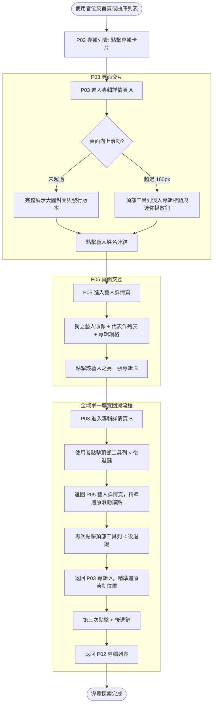
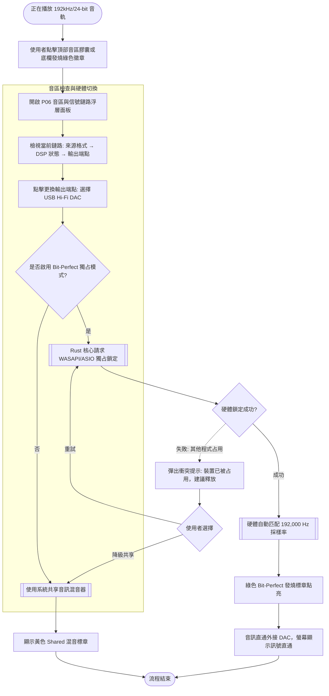
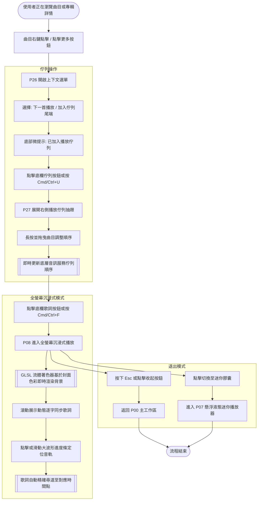

# Phase 3: 核心使用者互動流程 (User Flows)

---

## 核心流程 1：雙向專輯/藝人導覽與歷史堆疊 (Album/Artist Bi-directional Navigation & History Stack)

### 1.1 流程背景與痛點根治
在現代音樂軟體中，使用者常從「專輯列表」進入「專輯詳情（P03）」，點擊歌手姓名跳轉至「藝人詳情（P05）」，再由藝人的歷年作品進入另一張「關聯專輯（P03b）」。
- **痛點根治**：以往在詳情頁內部塞入次級返回按鈕（`showInlineBackButton`），會形成「頂部工具列有 `<` `>`，頁面主體又多一層 `← 返回`」的雙重冗餘，且在多層跳轉後歷史堆疊錯亂。
- **解決方案**：落實**「單一導覽錨點」**，所有深層探索完全由頂部全域歷史控制器統管，各頁面掛載 `PageStorageKey` 精確恢復滾動位置。

### 1.2 Mermaid 流程圖

### 1.3 步驟表 (Step Table)

| 步驟 | 頁面/組件 | 使用者操作 | 系統響應 | 異常與邊界處理 | 耗時預估 |
|------|----------|-----------|---------|---------------|---------|
| 1 | P02 專輯列表 | 單擊任一專輯卡片 | 觸發 `navController.push(albumId)`，主舞台執行平滑轉場 (`FadeThrough`) | 若快取無中繼資料，顯示骨架屏並後台載入 | < 150ms |
| 2 | P03 專輯詳情 | 向上滾動檢視曲目 | 當滾動量 > 180px，頂部 App Bar 標題插槽淡入專輯名稱與播放按鈕 | 滾動動效維持 60fps+，硬體 GPU 合成無卡頓 | < 16ms |
| 3 | P03 專輯詳情 | 點擊藝人連結文字 | 觸發 `navController.push(artistName)`，進入 P05 藝人詳情頁 | 藝人若無中繼資料，以本機標籤兜底展示 | < 200ms |
| 4 | P05 藝人詳情 | 點擊發行專輯 B | 觸發 `navController.push(albumIdB)`，進入 P03 專輯 B | 歷史棧深度 +1，頂部後退鈕保持高亮 | < 200ms |
| 5 | 全域頂部導覽列 | 點擊 `<` 歷史後退按鈕 (或按 `Alt+Left`) | 呼叫 `navController.goBack()`，依序倒退回 P05、P03(A)、P02 | 自動從 `PageStorage` 還原各層之 `scrollOffset` | < 100ms |

### 1.4 關鍵決策點 (Key Decision Points)
- **決策點 1：次級導覽列移除判定**
  - *條件*：檢測是否進入二級/三級詳情頁面。
  - *規則*：**一律不渲染**舊版 `IconButton(Icons.arrow_back_rounded)` 次級導覽橫條；頂部全域 `<` 鍵透過監聽歷史棧長度自動啟用（`canGoBack == true`）。
- **決策點 2：滾動吸頂（Sticky Header）觸發閾值**
  - *條件*：`scrollController.offset >= 180.0`。
  - *規則*：動態標題插槽以 `Curves.easeOutCubic` 執行透明度（0.0 → 1.0）漸變過渡；若滾動小於 180px，標題插槽保持完全透明。

---

## 核心流程 2：Bit-Perfect 獨占輸出與音區無縫切換 (Bit-Perfect Output & Zones Switch)

### 2.1 流程背景與價值
發燒音訊核心的核心訴求在於**「真實無損（Bit-Perfect）」**。當播放 192kHz/24-bit FLAC 或 DSD 音軌時，播放器必須避開 Windows/macOS 系統層的重取樣混音器，直接以硬體獨占（Exclusive Mode / Hog Mode）鎖定外接 DAC。

### 2.2 Mermaid 流程圖

### 2.3 步驟表 (Step Table)

| 步驟 | 頁面/組件 | 使用者操作 | 系統響應 | 異常與邊界處理 | 耗時預估 |
|------|----------|-----------|---------|---------------|---------|
| 1 | 底欄播放器 | 點擊信號鏈綠色徽章 | 以液態玻璃彈窗平滑展開 P06 音區與 Signal Path 面板 | 播放不中斷，背景保持微高斯模糊 | < 150ms |
| 2 | P06 音區面板 | 點擊切換至「USB DAC 2.0」 | 向音訊核心發送切換指令，檢測支援之採樣率陣列 (44.1k - 768k) | 若裝置離線，置灰並提示「裝置未就緒」 | < 300ms |
| 3 | P06 音區面板 | 開啟「Bit-Perfect 獨占輸出」開關 | 呼叫 Rust FFI 取得 WASAPI Exclusive / ASIO 控制權 | 若發生端點被獨占衝突，彈出無損降級詢問 | < 500ms |
| 4 | 音訊引擎底層 | (系統自動執行) | 自動切換硬體晶片時鐘至 192kHz，無混音直通 | 若有 DSP PEQ 啟用，以 64-bit 浮點計算並在鏈路如實標明 | < 100ms |
| 5 | P06 / 底欄 | 檢視信號鏈圖示 | Signal Path 顯示「Bit-Perfect 直通」字樣，徽章保持祖母綠高光 | 任何重取樣均轉為紫色 Resampled 標示 | < 50ms |

### 2.4 關鍵決策點 (Key Decision Points)
- **決策點 1：硬體獨占鎖定衝突**
  - *條件*：外部播放軟體搶占 WASAPI Exclusive。
  - *處置*：播放器不崩潰、不中斷，自動降級為高品質 Shared 模式，並在 Signal Path 彈出橙色警告提醒使用者關閉衝突程式。
- **決策點 2：DSD 播放模式決策**
  - *條件*：DAC 是否支援 Native DSD (ASIO) 或 DoP (DSD over PCM)。
  - *處置*：優先選擇 Native DSD，若不支援則自動啟用 DoP 封裝；若 DAC 僅支援 PCM，則以高品質 64-bit 浮點轉換為 176.4kHz PCM 並在鏈路明確標註。

---

## 核心流程 3：播放佇列管理與全螢幕沉浸式播放 (Track Queue & Fullscreen Now Playing)

### 3.1 流程背景與沉浸感演繹
使用者在日常欣賞高解析音樂時，需要彈性的播放佇列調度（插播、拖曳排序、清除），以及進入大螢幕沉浸聆聽模式（動態歌詞、液態流體著色器背景、大字體視覺）。

### 3.2 Mermaid 流程圖

### 3.3 步驟表 (Step Table)

| 步驟 | 頁面/組件 | 使用者操作 | 系統響應 | 異常與邊界處理 | 耗時預估 |
|------|----------|-----------|---------|---------------|---------|
| 1 | P03 / P09 曲目項 | 右鍵單擊曲目項 | 彈出 P26 歌曲上下文快捷操作選單 | 靠近邊界時選單自動翻轉朝向防止溢出 | < 50ms |
| 2 | P26 右鍵選單 | 點選「加入播放佇列」 | 音軌追加至佇列，底欄佇列計數角標 +1 動態彈跳 | 重複曲目不重複加入，輕量 Toast 提示 | < 100ms |
| 3 | 底欄右側 | 點擊佇列圖示 (或按 `Cmd+U`) | 右側展開 P27 播放佇列側邊欄 (寬度 360px) | 內容主視圖保持自適應，不擠壓佈局 | < 200ms |
| 4 | P27 佇列側邊欄 | 滑鼠拖曳曲目手柄上下排序 | 插入指示線即時跟手吸附，釋放後立即同步佇列索引 | 拖曳過程維持 60fps+，平滑動畫移位 | < 16ms |
| 5 | 底欄右側 | 點擊歌詞圖示 (或按 `Cmd+F`) | 主舞台以半透明淡入切換至 P08 全螢幕沉浸播放 | 頂部全域工具列與側邊欄平滑隱藏 | < 300ms |
| 6 | P08 全螢幕播放 | 聆聽音樂並滾動歌詞 | GLSL Shader 依照封面調色盤動態微波流動，當前歌詞高亮放大 | 無歌詞時優雅過渡為大封面 + 頻譜儀模式 | 60-120fps |
| 7 | P08 全螢幕播放 | 按下 `Esc` 鍵 | 平滑淡出全螢幕，還原至主工作區此前瀏覽位置 | 歷史位置與播放狀態完全無縫維持 | < 250ms |

### 3.4 關鍵決策點 (Key Decision Points)
- **決策點 1：全螢幕進入/退出時的介面狀態恢復**
  - *條件*：使用者由深層頁面（如 P03 專輯）進入 P08，再退出 P08。
  - *處置*：全螢幕視圖作為獨立 Overlay 層覆蓋於主工作區之上，退出時直接銷毀 Overlay，主工作區的導覽歷史棧（`NavHistoryController`）與各頁面狀態完全不被破壞。
- **決策點 2：動態歌詞無中繼資料兜底**
  - *條件*：當前音軌無內嵌 LRC 且串流服務無逐字歌詞。
  - *處置*：介面自動切換至「發燒封面大圖 + 64-bit 聲道頻譜儀 + 專輯發布故事」視圖，絕不出現大面積突兀的空白報錯。
